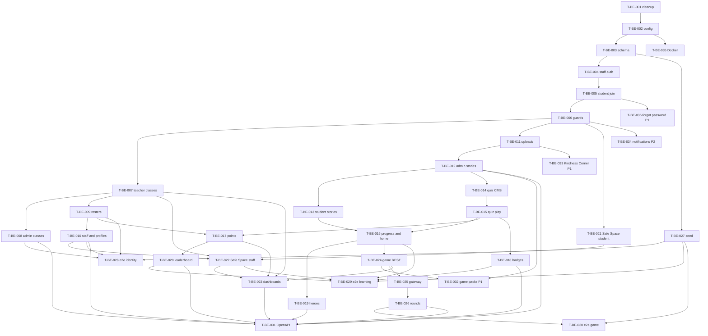

# Wings of Power — backend plan

Implementation plan for `wings_of_power_backend`. Contract sources, in order: `docs/API.md`, `docs/DATABASE.md`, `docs/REALTIME.md`, `docs/DECISIONS.md`, `docs/MODULE_MAP.md`. This file is the build order. It does not add endpoints.

`docs/TASK_TEMPLATE.md` is not in the repo. Every `docs/tasks/T-BE-###.md` file uses the shape below so one agent session can execute it. That shape matches `AGENTS.md` (Status, scope, allowed files, Notes) plus depends-on, endpoints, entities, required tests, and Done when.

Parent role is out of scope. Do not add Parent accounts, invites, or sockets.

Boilerplate patterns to keep using: Nest module slice (`module` / `controller` / `service` / `dto`), Prisma (not TypeORM, not a second `entities/` stub layer), global prefix `api`, `{ success, message?, data? }`, class-validator, JWT Bearer, `JwtAuthGuard`, `RolesGuard` + `@Roles`, `PaginationDto`, BullMQ `mail-queue`, Socket.io `IoAdapter`, Disk helper for uploads. CASL stays compiled and unused until a task says otherwise. Wings authorization is the three-role guard, not the permission matrix.

## Task file shape

```text
# T-BE-### — Title
**Status:** todo | in-progress | done
**Module:** one Nest area
**Depends on:** task ids, or none
**Priority:** foundation | P0 | P1 | P2

## Goal
## Scope
## Out of scope
## Allowed files          (about 10; plus this task file’s Status/Notes)
## Endpoints               (only rows from docs/API.md or events from docs/REALTIME.md)
## Entities
## Required tests
## Done when               (commands)
## Notes
```

An agent takes **one** task, touches only its allowed files, and updates that task’s **Status** and **Notes**. If a screen and the contract disagree, stop and add a proposed default to `docs/OPEN_QUESTIONS.md`. Do not invent a route to paper over the gap.

Standard check (cwd `wings_of_power_backend/`, package manager **yarn**):

```bash
yarn lint
yarn test
yarn test:e2e
yarn build
```

---

## Step 1 — boilerplate audit

The Nest tree is a reused template (volunteer/hurricane requests, community posts, Stripe, chat, LiveKit). Those modules are not Wings features. `docs/DATABASE.md` says the same about the Prisma models.

### Delete (not product)

**Feature modules — delete the whole directory**

| Path | What it is |
|------|------------|
| `src/modules/application/` | Hurricane `requests` (SEEKER/VOLUNTEER, storm categories), community posts/likes/comments, FAQ, contact form, demo notification gateway, LiveKit calls and streams. Also imported twice: `ApplicationModule` and a second `RequestModule` in `AppModule`. |
| `src/modules/admin/` | Template admin for FAQ, contact, payment transactions, volunteer approve/reject, chat-style notifications. Wings admin is rebuilt later under new controllers. |
| `src/modules/chat/` | Conversations, messages, chat users, chat notifications, `MessageGateway` (including audio-chunk recording). No student DMs. |
| `src/modules/payment/` | Stripe webhook, deposit (“deposite”), withdraw / connected accounts. |
| `src/prometheus/` | Generated CRUD stub plus `GET /api/metrics/hello`. Not a Wings screen. |

**Demo HTTP routes**

| Method | Path | Why |
|--------|------|-----|
| GET | `/api/test-chunk-stream` | Stream demo on `AppController` |
| GET | `/api/test-file-stream` | Reads `package.json` as a download |
| POST | `/api/test-file-upload` | Multer demo |
| GET | `/api/metrics` and `/api/metrics/hello` | Prometheus stub |
| POST | `/api/auth/register`, `/api/auth/login`, `/api/auth/update` | Generic user, not staff/student flows in `docs/API.md` |
| GET | `/api/auth/google`, `/api/auth/google/redirect` | Google OAuth. Not in the contract. |
| POST | `/api/auth/resend-verification-email`, `/api/auth/resend-token`, `/api/auth/verify-token` | Template token flow |
| POST | `/api/auth/request-email-change`, `/api/auth/change-email` | Not in the contract |
| POST | `/api/auth/refresh-token` | Contract returns `accessToken` only |
| POST | `/api/auth/generate-2fa-secret`, `verify-2fa`, `enable-2fa`, `disable-2fa` | TOTP demo |
| GET | `/api/auth/all-volunteer` | Volunteer directory |
| * | `/api/requests/*` | `create-request`, `available`, `completed-requests`, `my-requests`, `all-disasters`, `:id/details`, `:id/accept`, `:id/feedback` |
| * | `/api/post-community/*` | Posts, likes, comments |
| * | `/api/faq`, `/api/admin/faq` | FAQ |
| * | `/api/contact`, `/api/admin/contact` | Contact form |
| * | `/api/v1/streams/*`, `/api/v1/video-calls/*` | LiveKit / WebRTC |
| * | `/api/chat/user`, `/api/chat/message/*`, `/api/chat/conversation/*` | Chat |
| * | `/api/notification/*`, `/api/admin/notification/*` | Template notifications (Wings notifications are a later P2 module) |
| * | `/api/payment/stripe/webhook`, `/api/deposite/*`, `/api/withdraw/*` | Payments |
| * | `/api/admin/user/*`, `/api/admin/payment-transaction/*` | Template user and ledger admin |

**Prisma models and enums — drop in T-BE-003** (T-BE-001 only removes the code that uses them)

`Account`, `Ucode`, `PostCommunity`, `Comment`, `PostLike`, `Request`, `Feedback`, `Conversation`, `Participant`, `Message`, `NotificationEvent`, template `Notification`, `video_calls`, `live_streams`, `Role`, `Permission`, `PermissionRole`, `RoleUser`, `UserPaymentMethod`, `PaymentTransaction`, `Faq`, `Contact`, `Attachment`.

Enums: `UserType` (ADMIN/CLIENT/EDITOR/MAID/SEEKER/VOLUNTEER), `RequestStatus`, `UrgencyLevel`, `RequestCategory` (hurricane), `MessageStatus`.

The current `User` row is replaced by `docs/DATABASE.md` (role enum, `password_hash`, `school_id`, no balance/Stripe/2FA columns).

**Seed — delete the behavior in `src/command/seed.command.ts`**

- Roles: Super Admin `su_admin`, Admin, Project Manager, Member, Viewer (string ids `'1'`–`'5'`).
- Permissions for `SystemTenant`, `User`, `Role`, `Project`, `Task`, `Comment`.
- `permissionRole` joins for those roles.
- System user attached to role id `'1'`.

Wings seed data is T-BE-027, from the table in `docs/DATABASE.md`.

**Libraries and helpers only the demos use**

| Path | Why |
|------|-----|
| `src/common/lib/Payment/` | Stripe and PayPal |
| `src/common/lib/Fetch.ts` | Used only by those payment classes |
| `src/common/lib/Tajulvar/` | Unused string interpolator from the template author |
| `src/common/guard/has-plan/` | Subscription-plan guard |
| `src/common/middleware/subdomain.middleware.ts` | Unused multi-tenant host parse |
| `src/common/middleware/rawBody.middleware.ts` | Only the Stripe webhook needed the raw body |
| `src/common/repository/chat/` | Chat repo |
| `src/common/repository/transaction/` | Payment repo |
| `src/common/repository/notification/` | Template notification repo |
| `src/common/repository/ucode/` | Email-token table that T-BE-003 replaces with `AuthCode` |

**npm dependencies to remove in T-BE-002** (after the imports are gone): `stripe`, `livekit-server-sdk`, `passport-facebook`, `puppeteer`, `qrcode`, `speakeasy`, `prom-client`, and their `@types/*`.

**Compose services to remove in T-BE-035** (not in T-BE-001, so cleanup stays a code delete): `prometheus`, `grafana`, `turnserver` (coturn), `prometheus.yml`, `dockerfiles/coturn/`. `docs/REALTIME.md` says ignore LiveKit leftovers. Postgres and Redis stay.

**Auth behavior to strip in T-BE-001, then rewrite in T-BE-004 / T-BE-005:** Google strategy, 2FA methods on `UserRepository` (`qrcode` / `speakeasy`), `getAllVolunteers`, `convertTo`.

### Keep and reuse

| Piece | Where | Reuse as |
|-------|--------|----------|
| Nest 11 bootstrap | `src/main.ts` | Prefix `api`, CORS, helmet, `ValidationPipe` (`transform`, `whitelist`), exception filters, Swagger UI at `/api/docs`, static `/public` and `/storage`, `IoAdapter` |
| Config | `src/config/app.config.ts`, `ConfigModule.forRoot` | One config factory. T-BE-002 renames keys; do not add a second config system |
| Logging | `LoggerMiddleware` on `*` | Keep the hook. It is currently a no-op; do not replace it with a new logger library |
| Validation | class-validator DTOs + global pipe; `zod` is installed | New DTOs are class-validator + `@ApiProperty`. Do not add Zod DTOs for Wings routes (`zod-validation.pipe.ts` can stay unused) |
| Swagger | `DocumentBuilder` + `@nestjs/swagger` | Bearer auth, tags per module. Export is T-BE-031 |
| Database | `prisma/schema.prisma`, client output `prisma/generated`, `PrismaService` | T-BE-003 replaces the schema. Keep the service, the generated client path, and `src/common/repository/prisma.ts` singleton |
| Auth mechanics | `JwtModule`, `JwtStrategy`, `JwtAuthGuard`, `LocalAuthGuard`, `bcrypt`, `@GetUser()` | New flows call these. Set `ignoreExpiration: false` (it is `true` today). Password field becomes `password_hash` |
| Roles | `RolesGuard`, `@Roles`, `role.enum.ts` | Replace `ADMIN/CLIENT/EDITOR/MAID` with `STUDENT/TEACHER/ADMIN` in T-BE-006. Guard reads `user.role`, not `user.type` |
| Mail | `src/mail/` BullMQ queue `mail-queue`, EJS templates | Verification and staff invite. Drop the “member invitation” wording when those tasks edit the templates |
| Uploads | `src/common/lib/Disk/` (`LocalAdapter`, `S3Adapter`, `GCSAdapter`, `TajulStorage` wired in `main.ts`) | T-BE-011. Teachers do not upload story media |
| Pagination | `src/common/pagination/` | T-BE-007 changes the helper to the contract shape `{ items, total, page, perPage, lastPage }` with `perPage` max 100. Later list endpoints call that helper |
| Errors | `CustomExceptionFilter`, `PrismaExceptionFilter` | Keep. Map business rules to 409 / 422 as `docs/API.md` states |
| Redis + BullMQ | `AppModule` | Mail now; match timers stay in-process for MVP (`docs/REALTIME.md`) |
| Ability module | `src/ability/` | Leave in the build. Do not seed permissions and do not guard Wings routes with CASL |
| Health | `GET /api/` `AppController.getHello` | Keep one liveness route so the existing e2e still has a target. Rename the string in T-BE-002 |
| Commands | `nest-commander`, `src/cmd.ts`, `yarn cmd seed` | Keep the runner; replace the seed body |
| Tests | Jest unit `*.spec.ts`, e2e `test/jest-e2e.json` | Colocated service specs. Full HTTP journeys are T-BE-028–030 |
| Docker infra | `postgres`, `redis` in `docker-compose.yml` | Keep. App image is rewritten in T-BE-035 |

`UserRepository` stays as the user lookup used by the guard, but T-BE-003 rewrites it onto the new `User` model. Do not keep `attachRole` / `roleUser`.

Soft-delete file `src/prisma/middleware/softdelete.middleware.ts` is leftover: it names a `Note` model that is not in the schema, compares `deleted_at` to `false`, and `PrismaService` never registers it. Prisma 6 has no `$use`. T-BE-003 replaces it with a client extension.

---

## Step 2 — task index

Tasks are ordered so each session is one module and about ten files. Schema work is the exception: one Prisma schema plus the compile fixes it forces.

| Task | Title | Depends on | Blocks contract |
|------|--------|------------|-----------------|
| T-BE-001 | Delete demo modules, routes, and seed behavior | — | yes |
| T-BE-002 | Rename app, config, and env | 001 | yes |
| T-BE-003 | Database and migration baseline | 002 | yes |
| T-BE-004 | Staff auth and school bootstrap | 003 | yes |
| T-BE-005 | Student class-code join and login | 004 | yes |
| T-BE-006 | Role guards and accept-invite | 005 | yes |
| T-BE-007 | Teacher classes and join approval | 006 | yes |
| T-BE-008 | Admin classes, codes, requests | 007 | yes |
| T-BE-009 | Student accounts and rosters | 007 | yes |
| T-BE-010 | Staff admin and profiles | 009 | yes |
| T-BE-011 | Uploads | 006 | yes |
| T-BE-012 | Admin stories, chapters, pages, audio | 011 | yes |
| T-BE-013 | Student story reading APIs | 012, 006 | yes |
| T-BE-014 | Teacher chapter-quiz CMS | 012, 006 | yes |
| T-BE-015 | Student quiz play and points ledger writes | 014, 005 | yes |
| T-BE-016 | Progress and student home | 013, 015 | yes |
| T-BE-017 | Points, awards, point rules | 015, 009 | yes |
| T-BE-018 | Badges | 015, 006 | yes |
| T-BE-019 | Heroes | 016, 005 | yes |
| T-BE-020 | Kindness leaderboard | 017 | yes |
| T-BE-021 | Student Safe Space | 006 | yes |
| T-BE-022 | Staff Safe Space | 021, 007, 010 | yes |
| T-BE-023 | Teacher and admin dashboards | 007, 017, 022, 024 | yes |
| T-BE-024 | Game REST | 016, 006 | yes |
| T-BE-025 | Game gateway, matchmaking, reconnect | 024 | yes |
| T-BE-026 | Rounds, powers, shootout | 025 | yes |
| T-BE-027 | Dev seed | 003 | yes |
| T-BE-028 | E2E auth, classes, rosters | 008, 009, 010, 027 | yes |
| T-BE-029 | E2E stories, quizzes, points, Safe Space | 016, 018, 020, 022, 027 | yes |
| T-BE-030 | E2E game REST and socket connect | 026, 027 | yes |
| T-BE-031 | OpenAPI export | 008, 010, 012, 018, 019, 020, 023, 026 | yes — gate |
| T-BE-032 | Game question packs (P1) | 012, 024 | no |
| T-BE-033 | Kindness Corner admin (P1) | 011, 012 | no |
| T-BE-034 | Notifications (P2) | 006 | no |
| T-BE-035 | Docker and deploy | 001, 002 | no |
| T-BE-036 | Student forgot-password (P1) | 005 | no |

P0 chapter-quiz CMS is T-BE-014 even though the teacher UI still shows the game-pack builder (decision A4 / `docs/MODULE_MAP.md`).

`docs/tasks/T-BE-GAME-*.md` is a separate game slice. It is not in the graph above. Game HTTP and sockets for this plan are T-BE-024, T-BE-025, and T-BE-026. Do not run a `T-BE-GAME` task beside those.

No tasks for: Parent; student Audio Books; student Kindness Corner GET; admin Analytics; admin Settings; session-revoke APIs; Google/Facebook; refresh tokens; 2FA; bots for `SINGLE`.

---

## Decisions to record before coding

These are not silent inventions. The task that needs each one writes it into `docs/DECISIONS.md` (and `docs/DATABASE.md` when the schema changes) **before** the code.

1. **`AuthCode` table** (T-BE-003). Email verify and password reset need a hash, purpose, and expiry. `docs/DATABASE.md` has `StaffInvite.token_hash` but no verify/reset table. Proposed model: `email`, `purpose` `VERIFY_EMAIL | RESET_PASSWORD`, `code_hash`, `expires_at`, `used_at`.
2. **`User.school_id` nullable** (T-BE-003). Admin register happens before `POST /api/auth/school`. The documented FK is required; the auth flow cannot satisfy that. Nullable until the school row exists. Single-school MVP (D15) still means one school row after onboarding.
3. **`GamePackStory` join** (T-BE-003) instead of `story_ids String[]`, so packs reference real stories. Unique `(pack_id, story_id)`.
4. **Closed string sets become Prisma enums** (T-BE-003), per the database conventions: `QuizAttemptStatus`, `ReadingMode` (`READ | LISTEN`), `GameRoundPhase` (`INTRO | BUZZ | ANSWER | VOTE | SHOOTOUT | COMPLETE`), `TicketStatus` (`WAITING | MATCHED | CANCELLED`), `MediaType` (`IMAGE | VIDEO`). No new values.
5. **Logout is stateless.** `POST /api/auth/logout` returns ok. The client drops the JWT. No denylist and no refresh token.
6. **Pending students** get the same JWT shape with `status: PENDING`. `POST /api/auth/student/login` returns 422 `PENDING` until the account is `ACTIVE`. Register may return `accessToken` so `/api/auth/me` and hero select work. App routes use the active-student guard (422).
7. **Eligibility** (D2): `(completedStories >= required_stories OR completedChapters >= required_chapters) AND mean chapter-quiz best >= min_quiz_percent`. Missing config row uses 2 / 6 / 70. No attempts means 0%, not eligible.
8. **`SINGLE` match** is one human and scripted pack questions. No bot opponent (planner open question 9).
9. **Shootout** trusts `made` from the authenticated shooter inside the server window (`docs/REALTIME.md`).
10. **Badge thresholds** stay inside `criteria_json`. Do not hard-code the six badges’ rules (open question 1). Seed placeholders that do not auto-unlock.
11. **Leaderboard** sums `PointsLedger.kindness_amount` where `source = GAME_KINDNESS`. Return nickname and `avatar_url`, not hero art (decision A5).
12. **Negative points** are rejected.
13. **Pagination** list `data` is `{ items, total, page, perPage, lastPage }`.
14. **Replace** `prisma/migrations/20261012081508_init`. Nothing in production depends on the hurricane migration.
15. **JWT expiry** in `.env.example` is milliseconds (`86400000`) while `jsonwebtoken` treats a number as seconds. T-BE-002 sets the example to `86400` and documents seconds.

---

## Task graph



### What can run in parallel

After the task named in the first column is **done**, the tasks in the second column do not share files and can run together.

| Done | Parallel next |
|------|----------------|
| T-BE-002 | T-BE-003, and T-BE-035 (Docker does not need the schema) |
| T-BE-003 | T-BE-004 and T-BE-027 (seed writes Prisma only; e2e waits for both) |
| T-BE-005 | T-BE-006, then T-BE-036 any time |
| T-BE-006 | T-BE-007, T-BE-011, T-BE-021, T-BE-034 |
| T-BE-007 | T-BE-008 and T-BE-009 |
| T-BE-009 | T-BE-010 (same `users` module; do not start 010 beside 009) |
| T-BE-011 | T-BE-033 can wait; it needs T-BE-012 as well |
| T-BE-012 | T-BE-013 and T-BE-014. T-BE-032 also needs T-BE-024, because both use `GameModule` |
| T-BE-015 | T-BE-016 (also needs 013), T-BE-017 (also needs 009), T-BE-018 |
| T-BE-016 | T-BE-019 and T-BE-024 |
| T-BE-017 | T-BE-020 |
| T-BE-024 | T-BE-025, then only T-BE-026 |
| T-BE-022 and T-BE-024 and T-BE-017 and T-BE-007 | T-BE-023 |
| Features above plus T-BE-027 | T-BE-028, T-BE-029, T-BE-030 in parallel |
| Those three e2e tasks and T-BE-031 | contract-ready check (below) |

Do not parallelize tasks that share a file. In particular 004 → 005 → 006 all edit `auth.service.ts`, 009 → 010 both edit `src/modules/users/`, and 025 → 026 both edit `game.gateway.ts`. Several tasks append one import to `src/app.module.ts`. The module folders can be written in parallel; land those `AppModule` lines one at a time.

---

## Milestone: contract-ready

**Contract-ready** is the point where the Flutter app and the Next.js dashboard can drop mocks and call this API.

It is reached when **all** of the following are true:

- T-BE-001 through T-BE-031 are **done** (P0 HTTP from `docs/API.md`, socket events from `docs/REALTIME.md`, dev seed, the three e2e journeys, and `yarn openapi:export`).
- Swagger at `/api/docs` and `wings_of_power_backend/docs/openapi.json` match those P0 routes.
- A seeded database can log in as admin, teacher, and active student using the env passwords from T-BE-002 / T-BE-027.

Not required for the mock switch (they can land before or after without blocking it):

- T-BE-032 game packs (P1)
- T-BE-033 Kindness Corner (P1)
- T-BE-034 notifications (P2)
- T-BE-035 Docker/deploy
- T-BE-036 student forgot-password (P1)

P1 teacher Safe Space detail/notes and Safe Space visit counts are inside T-BE-021 / T-BE-022 so the module is finished once. P1 teacher class-create and code-renewal requests are inside T-BE-008 for the same reason. They are small additions on those modules, not extra milestones.

**Deploy-ready** is contract-ready plus T-BE-035 (image builds, compose is Postgres + Redis + API, no coturn/Grafana).
